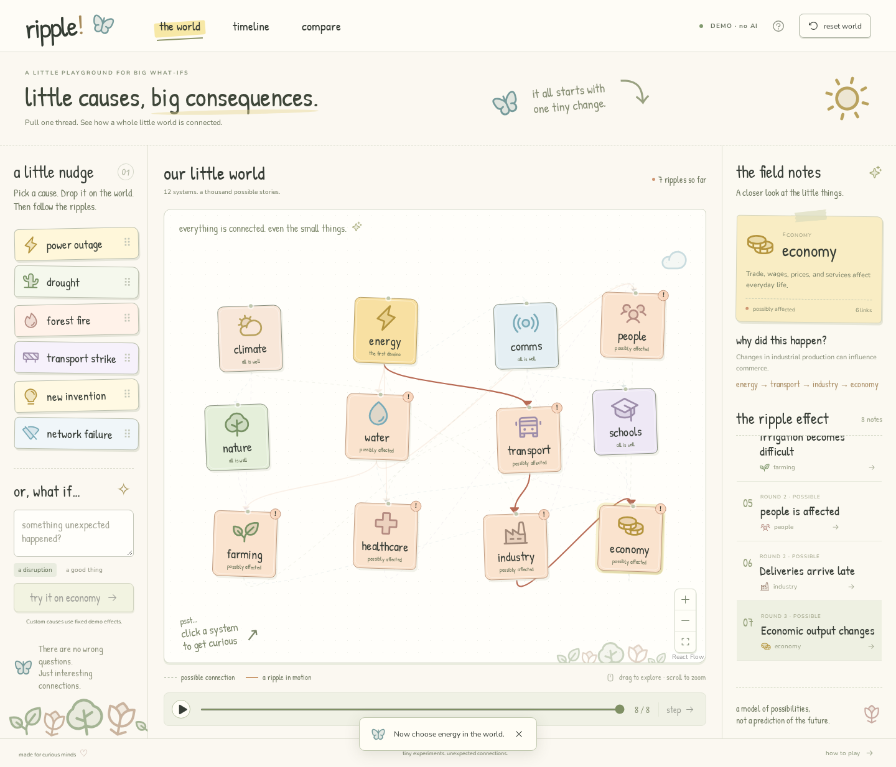

# ripple!

**Explore how a change might spread — then rehearse what happens if you intervene.**

[Try Quick Ripple](https://ripple.querencia.art) · [Local simulation guide](docs/LOCAL_SIMULATIONS.md)



Ripple still has its original pixel art and playful what-if maps. Now it also has an experimental **Simulation** mode for inspecting real inputs, comparing decisions and following stateful simulated agents.

## Two ways to explore

**Quick Ripple** is the original fast question → streaming graph. It uses Gemma when a server key is configured, or a clearly labeled offline demo. Its output is a map of possibilities, not verified facts.

**Simulation (experimental)** lets you:

- Save local projects and upload TXT, Markdown or CSV evidence.
- Review extracted claims and label missing or conflicting facts.
- Define subscription-pricing segments, current metrics and two alternatives.
- Run a bounded, **rule-based** multi-agent experiment with typed actions and private agent observations.
- Inspect events on the original pixel graph, replay, compare, fork a checkpoint and export Markdown/JSON reports.

An agent's decisions are simulated hypotheses. The calculated revenue illustrations assume historical churn stays fixed. **Neither is a calibrated prediction.**

## Run it yourself

Use Node.js 22 or newer.

```sh
git clone https://github.com/0xQuerencia/ripple.git
cd ripple
npm ci
npm run dev
```

Open the `localhost` URL Vite prints. Use **Projects** to create a project, then open **Simulation**. This rule-based local workflow does not need a Gemini key and does not send your uploaded files to a model provider.

For live **Quick Ripple**, copy `.env.example` to `.env` and set `GEMINI_API_KEY`. Quick Ripple questions are then sent to the configured Gemini API. Without a key it falls back to the labeled demo.

Projects persist in a local SQLite database at `./ripple-local.sqlite` by default. Set `RIPPLE_DB_PATH` to move it. See [local storage, privacy and backup](docs/LOCAL_SIMULATIONS.md).

## Checks

```sh
npm test
npm run build
npm run test:browser
npm run evaluate
```

`npm run evaluate` runs **synthetic integrity fixtures**. They test replay, evidence references and response to interventions; they do not establish forecast accuracy or performance against actual customer decisions.

## Code map

`shared/` contains validation and pure domain logic. `server/storage/` owns SQLite events and checkpoints, `server/jobs/` runs leased jobs, `server/simulation/` contains roles and state transitions, and `src/simulation/` adds the decision lab without replacing `src/map/`.

## Deployment status

Public Vercel and the default Docker deployment serve **Quick Ripple only**. A [private, single-owner server deployment](docs/PRIVATE_HOSTING.md) is available for an authenticated simulation lab. Simulation projects, sources and worker APIs are **local-only**, without hosted authentication or a PostgreSQL adapter. Do not expose them as a public multi-user service.

This is a local experimental release, not a validated or production-ready v1.0. Missing items include PDF ingestion, hosted storage and workers, real historical benchmark cases and verified customer-behavior calibration.

## Credits & license

Built with React, React Flow and Vite. The pixel icons use [Phosphor](https://phosphoricons.com/) (MIT), and augiepixel is by Augie Ruben. The original visual style was inspired by jamegam, without copying its art or code.

Ripple began at a Hack Day and has grown into an independent open-source project. MIT licensed.
