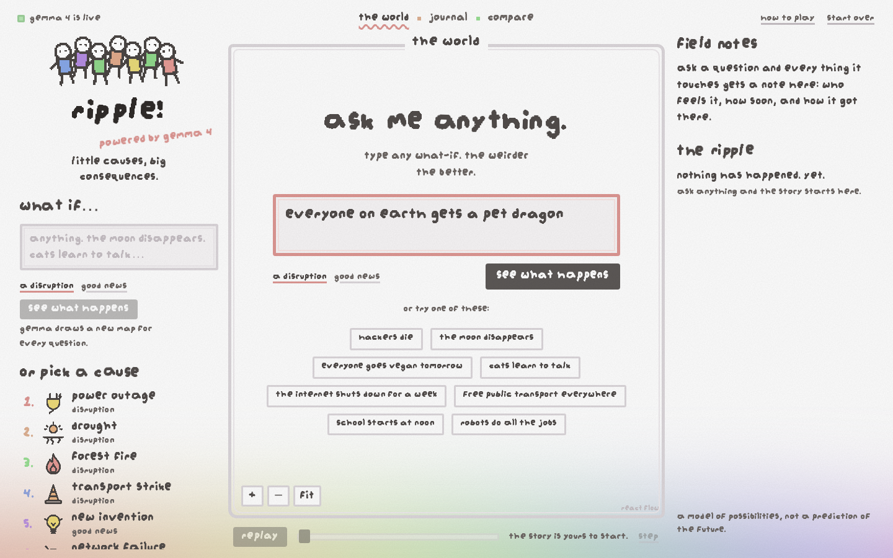
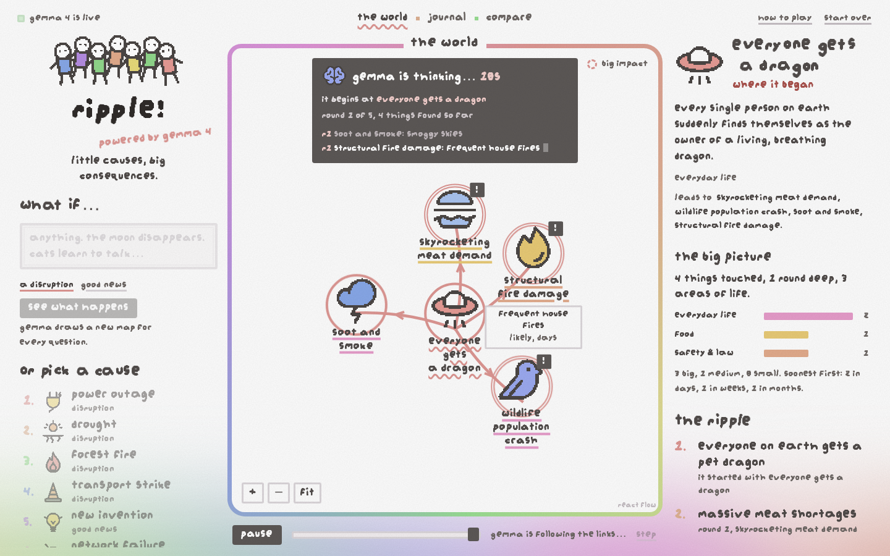
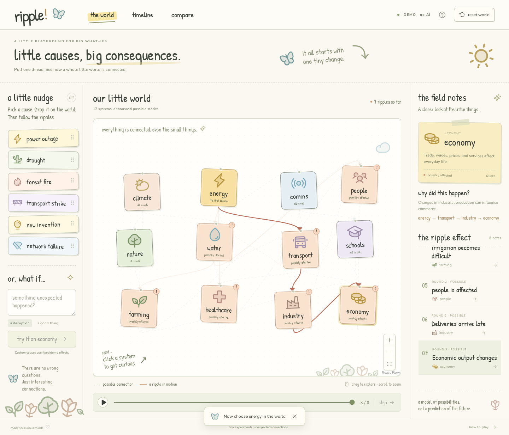

# ripple!

Type any what-if, and Gemma 4 draws a map of how it could ripple through the world.





Built for MLH: **Best Use of Gemma 4** (via the Gemini API) and **Best Open-Source AI Project** (MIT).

## What it does

- **Answers anything.** "The moon disappears." "Hackers die." "Cats learn to talk." Gemma invents a fresh map for every question, so there is no fixed list of things it knows about.
- **Shows its work live.** A panel counts the seconds, names the round it is on, and ticks off each effect as Gemma writes it, while the map grows underneath.
- **Gives every effect a story.** Who feels it, how soon, how sure Gemma is, and how big it is. Tap any node to trace how the ripple got there.
- **Adds it all up.** The "big picture" shows how many things were touched and which areas of life they landed in.
- **Fails honestly.** If Gemma can't be reached, a small offline demo takes over and the screen says so. It never pretends to be Gemma.

## Why it exists

A chat answer to "what would happen if…?" is a wall of text, and it is hard to see what leads to what. A fixed diagram can only cover the questions someone thought of in advance. Ripple lets the model draw the diagram, and uses code to keep that diagram well-formed.

Gemma can be wrong. Everything on screen is a possibility, not a prediction, and the app says so.

## Quick start

You need Node.js 22 or later and, for the real thing, a free [Gemini API key](https://aistudio.google.com/apikey).

```sh
npm ci
cp .env.example .env     # paste your key into GEMINI_API_KEY
npm run dev              # then open the address Vite prints (usually http://localhost:5173)
```

Without a key everything still runs in offline demo mode. The key stays on the server (`server/`) and never reaches the browser.

## How it works

1. **You ask.** The question goes to a small Node API (`server/api.mjs`).
2. **Gemma draws.** The server asks Gemma 4 for one JSON line per node: the cause, then up to 28 effects over 5 rounds, each with a name, an area of life, a pixel icon, who feels it, when, how sure, and which earlier nodes it follows from.
3. **Code checks every line before you see it** (`shared/ripple.mjs`). An effect must follow from a node that already exists, nothing repeats, rounds don't skip, the size limits hold, and every text field and choice is bounded or checked against a fixed list. That keeps the map well-formed and traceable. It **cannot** check the facts, which is why Gemma's answers are labelled as possibilities.
4. **The map grows as it streams.** The interface draws each node as it arrives: the cause in the middle, each round on a wider ring.
5. **Hiccups are handled.** Gemini sometimes returns a 500. The server retries, tries the larger Gemma on the last attempt, and only then falls back to the offline demo.

The stream format is written down in [`shared/types.js`](shared/types.js). The reasoning behind the non-obvious choices is in [`docs/NOTES.md`](docs/NOTES.md).

## Development

```sh
npm run dev            # app and API together, with hot reload
npm test               # 77 tests: validator, layout, graph, Gemma client, API (no network)
npm run test:browser   # 8 Chromium tests against the offline demo engine (port 5179)
npm run build          # production files in dist/
npm run sprites        # re-render the pixel sprites from the icon set
npm run format         # prettier
```

Where things live, by area:

| Folder | What it owns |
|---|---|
| `shared/` | Rules used by both sides: the ripple validator, the stream types, the known baseline map, the offline demo engine |
| `server/` | The API, the Gemma client, rate limits, the production server |
| `src/map/` | Drawing the ripple: layout, nodes, links, the camera |
| `src/ask/` | Asking: the big box, the stickers, examples |
| `src/notes/` | Reading the result: field notes, journal, compare, the big picture |
| `src/run/` | The live stream: state, the client, the thinking panel, playback |
| `src/ui/` | Small shared pieces: header, help, sprites, jiggling text |
| `src/styles/` | Design tokens first (`tokens.css`), then per-surface styles |
| `scripts/` | The sprite pipeline |

## Deploy

It is one small container with no database. See [`docs/DEPLOY.md`](docs/DEPLOY.md) for Docker, a reverse proxy with HTTPS, and the settings that matter (`TRUSTED_PROXY_HOPS` and the usage limits).

```sh
docker compose up -d --build
```

## Credits and disclosure

- **Existing work:** the baseline map (`shared/world.mjs`), the first validator, the canned demo effects and the first engine tests come from the project's supplied master spec. Everything else here was written for this project: the Gemma integration, the streaming server, the ripple validator, the interface and its tests.
- **Models and libraries:** Gemma 4 through the Gemini API (the server calls the REST API directly), [React](https://react.dev/) and [React Flow](https://reactflow.dev/) (MIT), [Vite](https://vite.dev/) (MIT), and [Phosphor Icons](https://phosphoricons.com/) (MIT) as the source of the pixel sprites.
- **Font:** [augiepixel](https://jamegam.hackclub.com/fonts/augiepixel.ttf) by Augie Ruben, free to use for anything without credit. Credit given anyway, thank you.
- **Visual inspiration:** the look (soft pixel handwriting, doodles, salmon notes, rainbow haze) is inspired by [jame gam by Hack Club](https://jamegam.hackclub.com/). No artwork or code from that site is used, and this project is not affiliated with Hack Club.
- **Built with AI help:** developed with Claude Code and the [Impeccable](https://github.com/pbakaus/impeccable) design skill (Apache-2.0).

Ripple is a toy for thinking about possibilities, not a forecasting tool.

## License

MIT, see [LICENSE](LICENSE).
